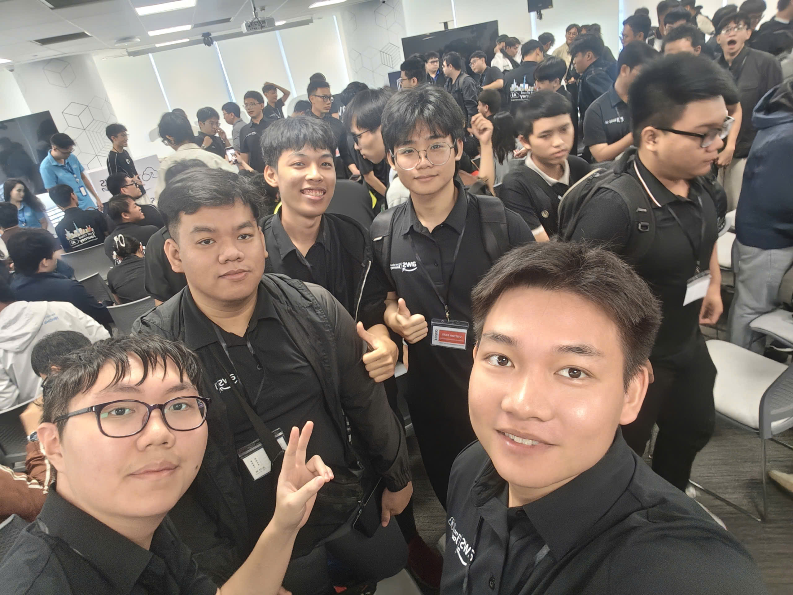

### Overview

**BUILDRATHON KICKOFF: CODE THE FUTURE WITH CMC GLOBAL** (September 26, 2026) kicked off the season by walking students through real AWS career paths, practical uses of Generative AI and AI Agents, and how to connect cloud skills with business needs.

### Speakers

* **Nguyen Gia Hung** – AWS
* **Bui Nhat Truong** – CMC Global

### Key Highlights

* **Generative AI & AI Agents in Practice:** The speakers walked through concrete enterprise examples showing how AI automates repetitive workflows rather than being bolted on for hype.
* **Hands-on Challenge & Q&A:** Attendees got a look at a starter AI Agent challenge and asked direct questions about moving prototypes into real use.
* **Networking:** A good chance to meet other students in the cohort and hear candid career advice.

### Key Takeaways & Application

* **Start from the problem, not the tool (business-first):** Picking shiny tech means little if it doesn't solve an actual pain point.
* **Keep learning continuously:** Cloud and AI move fast, so staying consistent with hands-on labs throughout the internship matters.

### Personal Reflection

As my first in-person event at the AWS office during the internship, it was a really energizing start. Both speakers kept things practical and approachable, making it much easier to see how enterprise cloud projects are scoped.

### Event Photos

