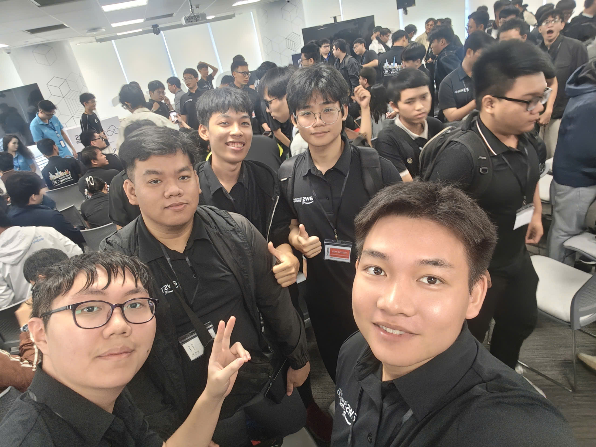

### Giới thiệu chung

Buổi **BUILDRATHON KICKOFF: CODE THE FUTURE WITH CMC GLOBAL** (26/09/2026) là sự kiện mở màn giúp sinh viên hiểu rõ hơn về công việc thực tế với AWS, xu hướng Generative AI / AI Agent và cách chuẩn bị kỹ năng cho nghề kỹ sư phần mềm.

### Diễn giả

* **Nguyễn Gia Hưng** – AWS
* **Bùi Nhật Trường** – CMC Global

### Nội dung chính

* **Generative AI & AI Agent trong doanh nghiệp:** Hai diễn giả lấy ví dụ cụ thể về cách doanh nghiệp ứng dụng AI để tự động hóa các khâu lặp lại và hỗ trợ ra quyết định, thay vì làm AI chỉ để chạy theo phong trào.
* **Thử thách thực hành & Q&A:** Người tham dự được giới thiệu đề bài xây dựng AI Agent cơ bản và hỏi đáp trực tiếp về những khó khăn khi mang ý tưởng ra chạy thật.
* **Giao lưu:** Cơ hội làm quen với các bạn sinh viên cùng khóa và nghe các anh chia sẻ góc nhìn tuyển dụng thực tế.

### Điều rút ra & Áp dụng

* **Đi từ bài toán trước, chọn công nghệ sau (business-first):** Giải pháp kỹ thuật chỉ có ý nghĩa khi giải đúng vấn đề người dùng đang gặp.
* **Chủ động cập nhật kiến thức:** Công nghệ Cloud và AI đổi rất nhanh, nên tôi cần giữ thói quen tự đọc tài liệu và làm lab đều đặn suốt kỳ thực tập.

### Cảm nhận cá nhân

Đây là sự kiện đầu tiên tôi đi trực tiếp ở văn phòng AWS trong kỳ thực tập nên khá hào hứng. Cách chia sẻ của anh Hưng và anh Trường rất gần gũi, dễ hiểu, giúp tôi định hình rõ hơn cách bắt đầu với bài toán thực tế thay vì chỉ làm bài tập trên lớp.

### Hình ảnh sự kiện

