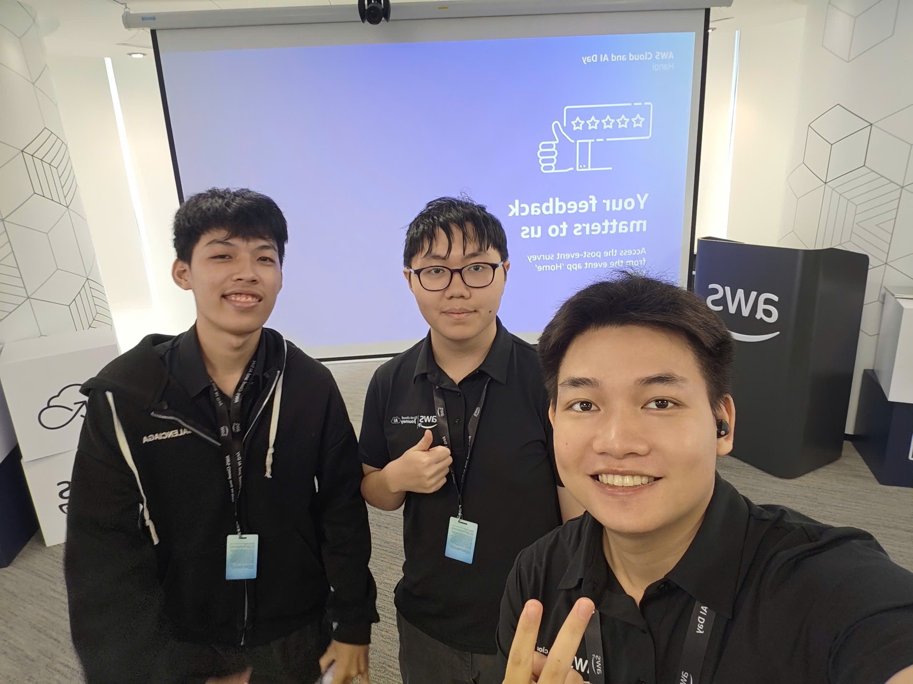
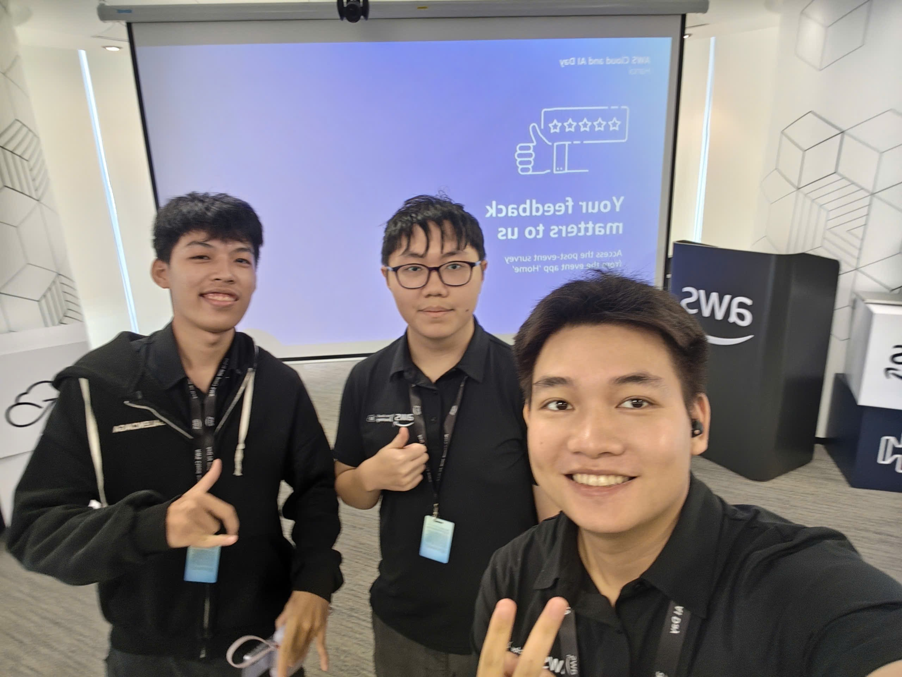

### Overview

I joined **AWS Cloud and AI Day Hanoi** via the Watch Party hub in Ho Chi Minh City (26th floor, Bitexco Tower). Even remotely, watching alongside other local students and engineers kept the energy high across keynotes on Cloud modernization, data foundations, and Agentic AI.

### Featured Speakers

* **Pham Duc Long** – Deputy Minister of Science and Technology
* **Jennifer Wicks** – U.S. Ambassador to Vietnam
* **Dr. Werner Vogels** – CTO, Amazon.com
* **Eric Yeo** – Country General Manager (Malaysia, Vietnam, Indochina), AWS
* **Dr. Jens Lottner** – CEO, Techcombank
* **Mai Le** – Director of Product Management, Katalon
* Alongside Solutions Architects from AWS, VPBank, and Cloud Kinetics.

### Key Highlights

* **Agentic AI Keynote:** Highlighted the shift from simple prompt-response AI to autonomous agents capable of planning steps, invoking tools, and assisting across the software lifecycle.
* **Modernization with AWS Transform:** Showed how larger organizations tackle legacy technical debt faster using automated migration tooling.
* **AI-Ready Data Foundation:** Reinforced that no model performs well if the underlying data pipeline is messy or poorly governed.

### Key Takeaways & Application

* **Data comes first:** Whether building a large enterprise platform or our own SecureLearn anomaly pipeline, clean and well-structured access logs matter more than tweaking the model blindly.
* **Broader infrastructure awareness:** Picked up practical context around Internal Developer Platforms (IDP) on EKS and integrating LLMs into developer workflows.

### Personal Reflection

Attending the Ho Chi Minh City Watch Party was a fun experience. Whenever an interesting demo came up, we immediately discussed it with friends sitting nearby. Hearing concrete stories from Techcombank and Katalon made enterprise-scale cloud challenges much easier to picture.

### Event Photos

