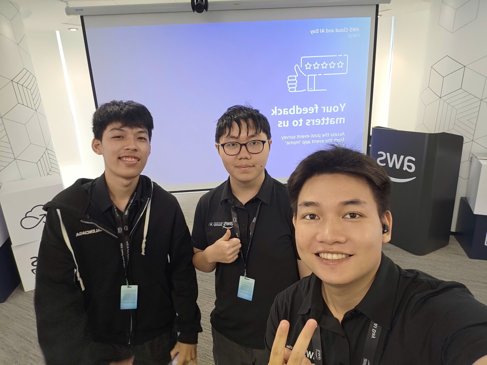
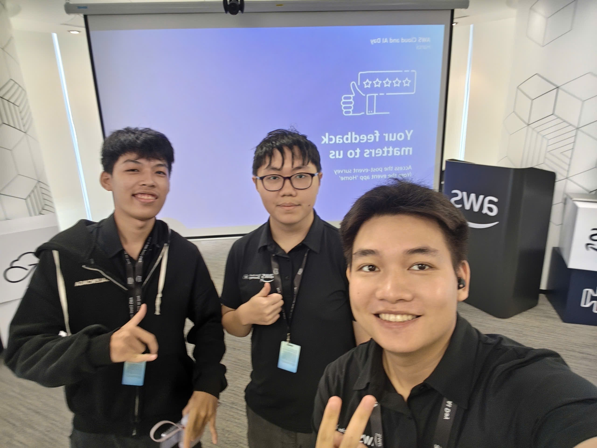

### Giới thiệu chung

Tôi tham dự **AWS Cloud and AI Day Hanoi** qua điểm cầu Watch Party tại TP.HCM (tầng 26 tòa nhà Bitexco). Dù không ở trực tiếp hội trường chính ngoài Hà Nội, buổi theo dõi chung vẫn rất sôi nổi với nhiều phiên chia sẻ lớn về Cloud, dữ liệu và Agentic AI.

### Diễn giả tiêu biểu

* **Phạm Đức Long** – Thứ trưởng Bộ Khoa học & Công nghệ
* **Jennifer Wicks** – Đại sứ Mỹ tại Việt Nam
* **Dr. Werner Vogels** – CTO, Amazon.com
* **Eric Yeo** – Country General Manager (Malaysia, Vietnam, Indochina), AWS
* **Dr. Jens Lottner** – CEO, Techcombank
* **Mai Le** – Director of Product Management, Katalon
* Cùng các Solutions Architect từ AWS, VPBank và Cloud Kinetics.

### Nội dung đáng chú ý

* **Keynote về Agentic AI:** Cho thấy bước chuyển từ AI chỉ trả lời câu hỏi sang AI Agent có thể tự chia bước, gọi công cụ và xử lý một phần quy trình phát triển phần mềm (SDLC).
* **Hiện đại hóa hệ thống với AWS Transform:** Cách doanh nghiệp giảm nợ kỹ thuật và chuyển đổi ứng dụng cũ quy mô lớn nhanh hơn nhờ tự động hóa.
* **Nền tảng dữ liệu cho AI (AI-Ready Data):** Nhấn mạnh rằng mô hình có mạnh đến đâu mà dữ liệu nguồn lộn xộn hoặc thiếu bảo mật thì kết quả vẫn sai lệch.

### Điều rút ra & Áp dụng

* **Dữ liệu là gốc:** Khi thiết kế bất kỳ hệ thống nào có AI (như nhánh quét log bất thường trong SecureLearn), khâu chuẩn hóa định dạng log và bảo mật dữ liệu phải làm kỹ ngay từ đầu.
* **Mở rộng góc nhìn hạ tầng:** Nắm thêm các khái niệm thực tế như Internal Developer Platform (IDP) trên EKS và cách tích hợp LLM vào quy trình phát triển phần mềm.

### Cảm nhận cá nhân

Ngồi xem Watch Party cùng các bạn sinh viên ở TP.HCM khá vui vì nghe tới đoạn nào hay cả nhóm lại bàn luận luôn tại chỗ. Ấn tượng nhất với tôi là câu chuyện chuyển đổi thật từ Techcombank và Katalon; nghe xong mới thấy quy mô bài toán ngoài doanh nghiệp khác hẳn đồ án nhỏ ở trường.

### Hình ảnh sự kiện

