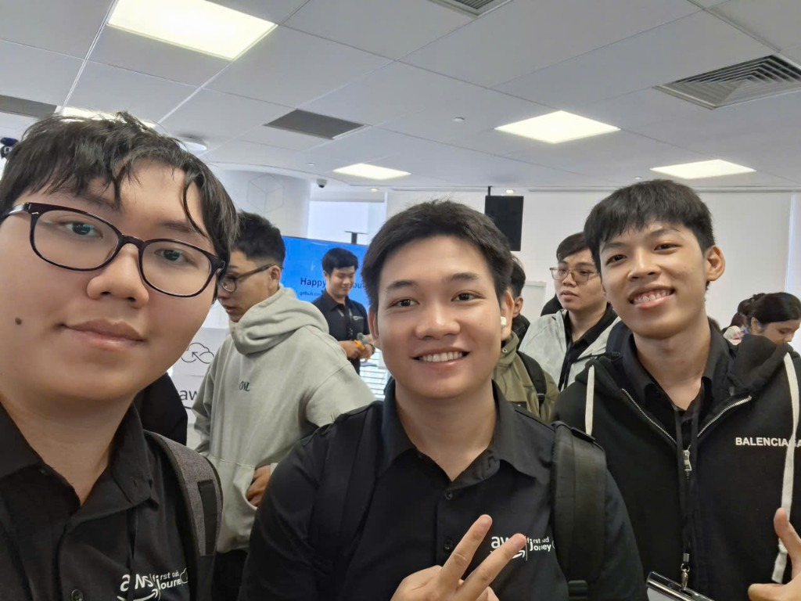

### Overview

**AWS First Cloud AI Journey Community Day 2026** (October 31, 2026 at Bitexco Financial Tower) brought together students and engineers to share practical cloud engineering lessons, covering Software Factory pipelines, Serverless cost optimization, Amazon SQS decoupling, AWS certification prep, and open-source contributions.

### Speakers

* **Thinh Nguyen** – STYL Solutions
* **Henry Duc Bui** – CloudThinker
* **Hung Tran** – NAB
* **Dao Luong**, **Khang Duong**, **Tuan Tran** – FCAJ

### Key Highlights

* **Software Factory in Practice:** Real lessons from building automated build, test, and deployment pipelines at scale and avoiding common operational pitfalls.
* **AWS Lambda & Amazon SQS:** How multi-concurrency and Active CPU Billing cut Serverless costs, and how SQS plus Dead Letter Queues (DLQ) absorb traffic spikes cleanly.
* **3-Month Internship Stories & AWS Certifications:** Candid recaps of building a real Serverless project (Lambda, S3, DynamoDB, CloudFront), debugging production issues, and using AWS Skill Builder toward Cloud Practitioner and Solutions Architect – Associate.
* **Getting Started with Open Source:** Practical advice on landing your first GitHub pull requests and maintaining steady contributions.

### Key Takeaways & Application

* **Applied directly to SecureLearn:** Seeing how alumni structured and debugged multi-service AWS apps helped a lot when wiring our own cloud flows.
* **Clearer certification path:** Using AWS Skill Builder alongside hands-on labs to prepare steadily for AWS Solutions Architect – Associate after the internship.

### Personal Reflection

This was one of my favorite sessions because the talks felt candid and relatable rather than overly theoretical. Hearing previous interns walk through their own 3-month journey gave me a real boost right as we entered the busy SecureLearn build phase.

### Event Photos

