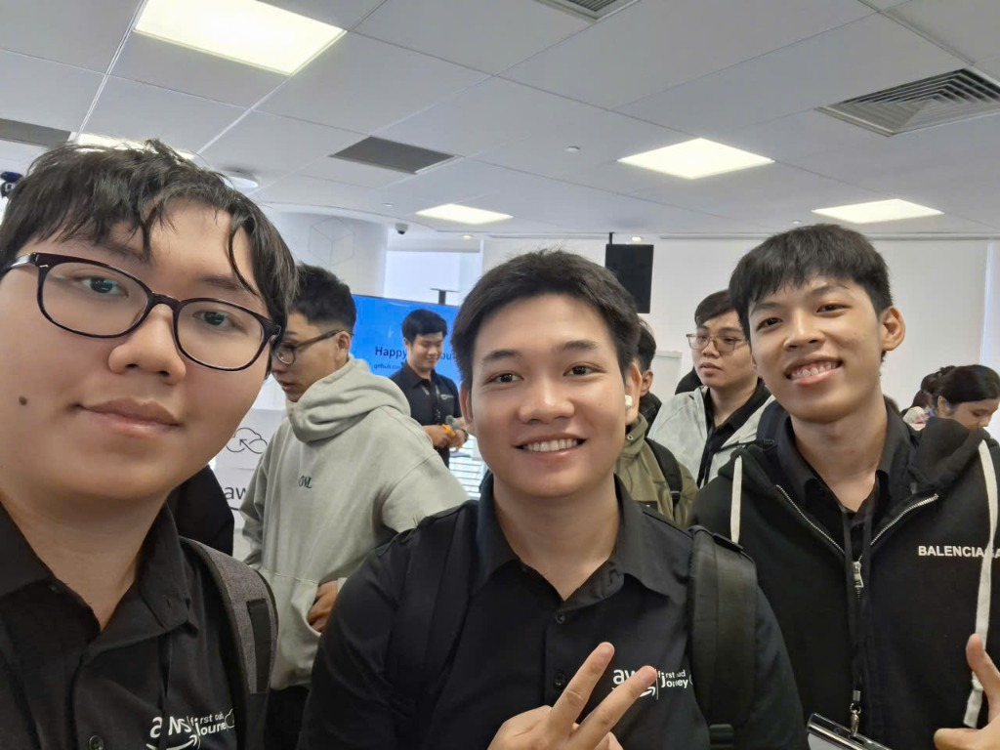

### Giới thiệu chung

**AWS First Cloud AI Journey Community Day 2026** (31/10/2026 tại Bitexco Financial Tower) là buổi giao lưu cộng đồng tập trung vào kinh nghiệm làm Cloud thực tế: từ Software Factory, tối ưu chi phí Serverless, xử lý bất đồng bộ với SQS cho tới chia sẻ lộ trình thi chứng chỉ AWS và đóng góp Open Source.

### Diễn giả

* **Thịnh Nguyễn** – STYL Solutions
* **Henry Đức Bùi** – CloudThinker
* **Hùng Trần** – NAB
* **Đào Lương**, **Khang Dương**, **Tuấn Trần** – FCAJ

### Nội dung đáng chú ý

* **Software Factory:** Kinh nghiệm dựng pipeline tự động hóa đóng gói, kiểm thử và triển khai trong doanh nghiệp, cùng các lỗi hay gặp khi mở rộng quy mô.
* **AWS Lambda & Amazon SQS:** Phân tích cách tối ưu chi phí Serverless (multi-concurrency, Active CPU Billing) và vai trò của SQS + Dead Letter Queue (DLQ) giúp tách tải khi lưu lượng tăng đột biến.
* **Câu chuyện 3 tháng thực tập & Ôn chứng chỉ AWS:** Các anh chị đi trước kể thật về quá trình làm đồ án Serverless (Lambda, S3, DynamoDB, CloudFront), cách tự gỡ lỗi và lộ trình ôn luyện qua AWS Skill Builder để thi Cloud Practitioner / Solutions Architect – Associate.
* **Đóng góp Open Source:** Hướng dẫn cách tạo những Pull Request đầu tiên trên GitHub để rèn kỹ năng và làm đẹp hồ sơ năng lực.

### Điều rút ra & Áp dụng

* **Áp dụng ngay vào SecureLearn:** Phần chia sẻ về kiến trúc bất đồng bộ và cách tự debug dịch vụ AWS giúp tôi hiểu rõ hơn khi phối hợp tích hợp các luồng trên Cloud.
* **Lộ trình cá nhân rõ ràng hơn:** Tận dụng AWS Skill Builder và các lab thực hành để ôn dần cho chứng chỉ AWS Solutions Architect – Associate sau khi kết thúc kỳ thực tập.

### Cảm nhận cá nhân

Đây là một trong những buổi tôi thích nhất vì các diễn giả nói rất thẳng và sát thực tế, không bị nặng lý thuyết. Nghe câu chuyện 3 tháng thực tập của mấy anh chị khóa trước cũng giúp tôi tự tin hơn hẳn cho giai đoạn chạy nước rút dự án SecureLearn.

### Hình ảnh sự kiện

