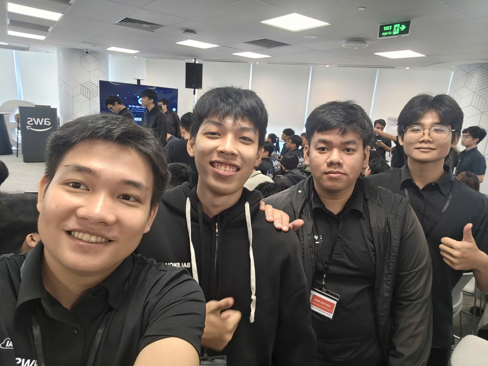

### Overview

**“Navigating the Future of Cloud & AI in Vietnam”** centered on systems thinking and operational lessons from **Dr. Werner Vogels** (CTO of Amazon.com), tackling the question on every software student's mind: *Will AI replace developers?*

### Speaker

* **Dr. Werner Vogels** – Chief Technology Officer (CTO) & Vice President, Amazon.com

### Key Highlights

* **The December 12 Outage & the Birth of DynamoDB:** Over 20 years ago, a relational database bottleneck took down Amazon's customer data for an entire day. Analyzing actual traffic showed 70% of queries were simple key-value lookups and only 10% truly needed relational joins, which led Amazon to build Dynamo, the foundation for Amazon DynamoDB.
* **Four Operational Habits at Scale:**
  * Measure tail latency at **P99.9** rather than hiding bad user experiences behind median numbers.
  * Design assuming *"Everything fails all the time"* so losing an entire data center doesn't stop the service.
  * Practice failure deliberately through **GameDays**.
  * Pay-as-you-go economics keep cloud providers accountable for reliability every day.
* **The "Renaissance Developer":** AI won't replace engineers who cultivate curiosity, systems thinking, ownership over production code, T-shaped skills, and clear communication of technical trade-offs.

### Key Takeaways & Application

* **Match the database to the access pattern:** Splitting relational course data in RDS PostgreSQL from high-volume access logs in DynamoDB in SecureLearn mirrors this exact first-principles approach.
* **Own what AI generates:** AI speeds up prototyping dramatically, yet humans remain responsible for security, edge cases, and architecture.

### Personal Reflection

My favorite line from the talk was Grace Hopper's quote: *"The most dangerous phrase in the language is, 'We've always done it this way.'"* Leaving the session, I felt far less anxious about AI replacing developers and more motivated to understand systems end to end, from Frontend UI to AWS infrastructure.

### Event Photos

