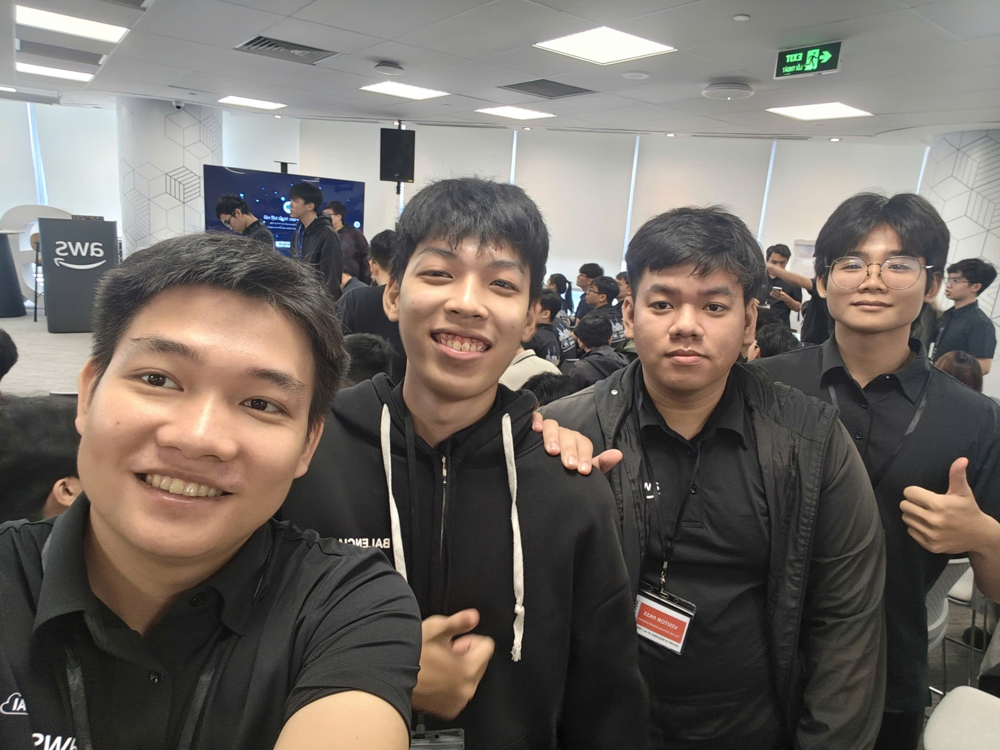

### Giới thiệu chung

Buổi chia sẻ **“Navigating the Future of Cloud & AI in Vietnam”** xoay quanh những bài học tư duy kiến trúc và vận hành thực chiến từ **Dr. Werner Vogels** (CTO Amazon.com), đặc biệt là câu hỏi mà sinh viên IT nào cũng quan tâm: *AI có thay thế lập trình viên không?*

### Diễn giả

* **Dr. Werner Vogels** – Chief Technology Officer (CTO) & Vice President, Amazon.com

### Nội dung đáng nhớ

* **Sự cố ngày 12/12 và sự ra đời của DynamoDB:** Hơn 20 năm trước, một đợt quá tải cơ sở dữ liệu quan hệ đã làm hệ thống Amazon sập cả ngày. Khi đo lại tải thực tế, đội ngũ phát hiện 70% truy vấn chỉ là đọc/ghi Key-Value đơn giản, chỉ 10% thực sự cần tính năng quan hệ. Từ đó Amazon tự xây dựng Dynamo (tiền thân của Amazon DynamoDB).
* **4 nguyên tắc vận hành hệ thống lớn:**
  * Đo độ trễ ở mức **P99.9** thay vì chỉ nhìn trung vị (median).
  * Thiết kế với giả định *"Everything fails all the Time"* để chịu lỗi khi mất cả trung tâm dữ liệu.
  * Diễn tập sự cố thật bằng **GameDays** thay vì đợi lỗi xảy ra mới xử lý.
  * Mô hình pay-as-you-go buộc nhà cung cấp cloud phải giữ chất lượng ổn định liên tục.
* **Chân dung "Renaissance Developer":** AI sẽ không thay thế lập trình viên nếu người làm kỹ thuật rèn được 5 điểm: tò mò học hỏi, tư duy hệ thống, tinh thần chịu trách nhiệm (ownership), kiến thức chữ T (T-Shaped) và giao tiếp rõ ràng bài toán kỹ thuật với nghiệp vụ.

### Điều rút ra & Áp dụng

* **Chọn đúng công cụ theo dữ liệu:** Nhìn lại bài toán SecureLearn, việc tách dữ liệu quan hệ (khóa học, bài học) sang RDS PostgreSQL còn log truy cập tần suất cao đẩy sang DynamoDB cũng xuất phát từ đúng tư duy phân tích mẫu truy vấn này.
* **Không ỷ lại vào code AI sinh ra:** AI giúp dựng prototype nhanh hơn rất nhiều, nhưng người viết vẫn phải chịu trách nhiệm kiểm tra bảo mật, edge cases và luồng hoạt động cuối cùng.

### Cảm nhận cá nhân

Tôi rất thích câu trích dẫn của Đô đốc Grace Hopper trong bài nói: *"Câu nói nguy hiểm nhất là 'Chúng ta luôn làm theo cách này'"*. Nghe xong buổi này tôi bớt lo chuyện AI thay thế người code, mà tập trung hơn vào việc hiểu toàn cảnh hệ thống (từ FE đến Cloud) thay vì chỉ học thuộc cú pháp.

### Hình ảnh sự kiện

