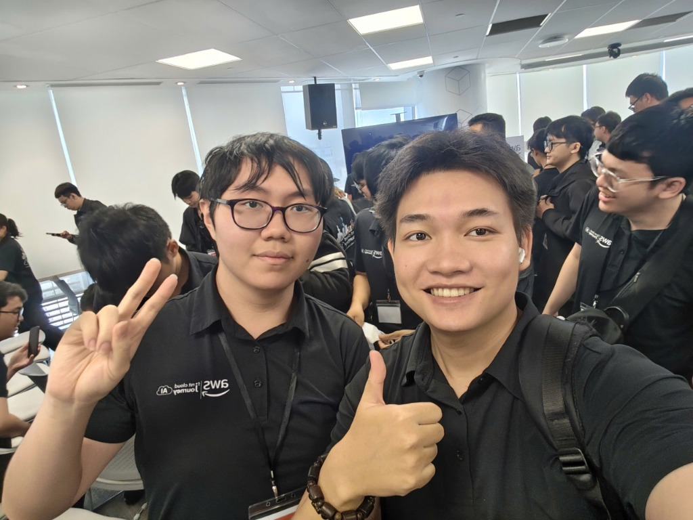

### Overview

This session on **November 14, 2026** brought together five speakers from FCAJ and industry engineering teams to cover the full lifecycle of production AI, from deciding when to use AI Agents and Shared Agent Platforms to optimizing Cloud infrastructure and Backend resilience on AWS.

### Speakers

* **Khanh Duong** – FCAJ
* **Huyen** – FCAJ
* **Nguyen Lam Anh** – AI Engineer, FCAJ
* **Nguyen Quoc Bao** – Cloud Engineer
* **Huynh An Khang** – Backend Engineer

### Key Highlights

* **Moving AI from Local to Production (Khanh Duong):** Contrasted local prototypes with production demands (concurrency, latency, monitoring, cost) and stressed clear **Guardrails** defining what an AI system is allowed (and forbidden) to do.
* **Using AI Agents Purposefully (Huyen):** Avoid forcing AI Agents into simple fixed workflows where a standard pipeline or single LLM call is faster and cheaper; reserve agents for multi-step reasoning and tool use.
* **Shared Agent Platform (Nguyen Lam Anh):** Centralizing model connectors, tools, memory, guardrails, and logging so teams don't rebuild the same plumbing from scratch.
* **Cloud Optimization for AI (Nguyen Quoc Bao):** Choosing between Bedrock, ECS/EKS, and GPU EC2 instances by stage, cutting token spend via **Semantic Caching** (Redis), and keeping traffic private with **VPC Endpoints / PrivateLink**.
* **Backend Patterns for AI (Huynh An Khang):** Streaming tokens with **SSE / WebSocket**, offloading heavy jobs to async queues (SQS), enforcing **Structured Outputs (JSON Schema)**, and using **Circuit Breakers / Multi-model Fallbacks** when upstream models rate-limit or fail.

### Key Takeaways & Application

* **Reliability beats flashy demos:** Production AI requires balancing latency, cost, and safety rather than just chasing cool prototypes.
* **Better FE–BE alignment:** Streaming responses (SSE) and strict JSON schemas make Frontend integration far cleaner and more resilient.

### Personal Reflection

What made this session stand out was how smoothly all five talks connected, from AI product criteria and Shared Platforms down to Cloud cost tuning and Backend error handling. Many of the local-vs-production caveats the speakers shared mirrored issues our own team was navigating while finalizing SecureLearn.

### Event Photos

