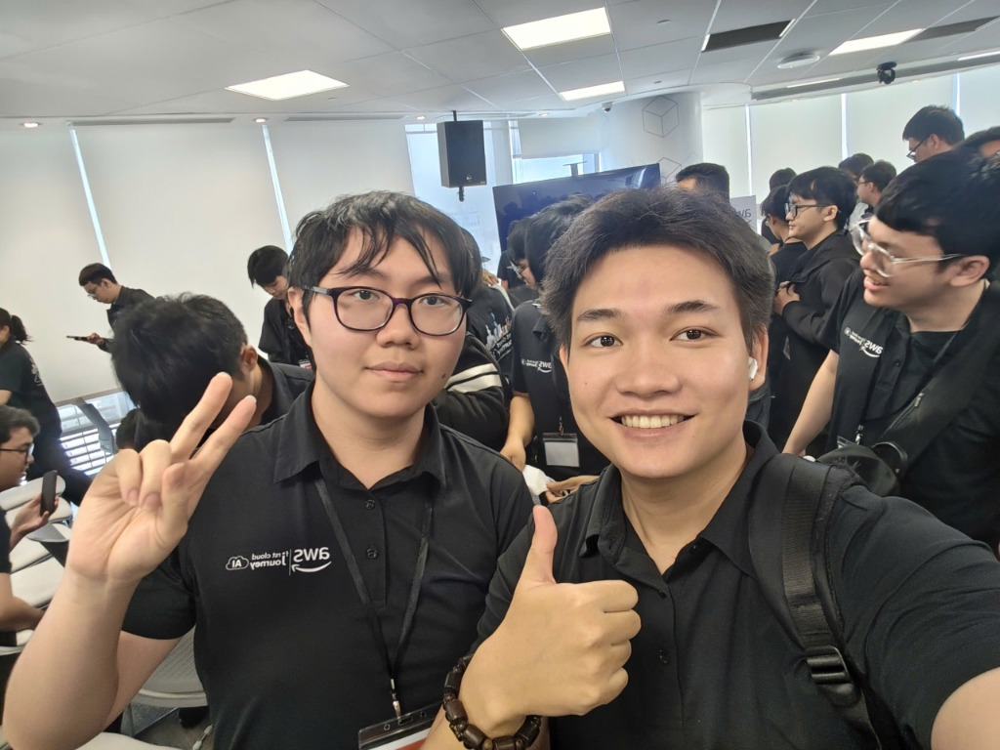

### Giới thiệu chung

Buổi chia sẻ ngày **14/11/2026** quy tụ 5 diễn giả từ cộng đồng FCAJ và các kỹ sư thực chiến, đi trọn một vòng từ cách đánh giá bài toán AI Agent, mô hình Shared Agent Platform cho đến tối ưu hạ tầng Cloud và kiến trúc Backend khi đưa AI từ local lên production trên AWS.

### Diễn giả

* **Khanh Duong** – FCAJ
* **Huyen** – FCAJ
* **Nguyen Lam Anh** – AI Engineer, FCAJ
* **Nguyen Quoc Bao** – Cloud Engineer
* **Huynh An Khang** – Backend Engineer

### Nội dung đáng chú ý

* **Đưa AI từ Local lên Production (Khanh Duong):** Chỉ rõ khoảng cách giữa bản chạy thử ở máy cá nhân với môi trường thật (tải đồng thời, log, chi phí) và tầm quan trọng của **Guardrails** để phân định rạch ròi điều AI được phép và không được phép làm.
* **Dùng AI Agent đúng chỗ (Huyen):** Không phải bài toán nào cũng cần AI Agent; nếu luồng cố định đơn giản thì workflow thường hoặc gọi LLM một bước vừa nhanh vừa tiết kiệm hơn. Chỉ dùng Agent cho tác vụ nhiều bước cần suy luận và gọi công cụ.
* **Shared Agent Platform (Nguyen Lam Anh):** Thay vì mỗi nhóm tự dựng lại từ đầu, nền tảng dùng chung chuẩn hóa kết nối model, tools, bộ nhớ, guardrails và logging giúp mở rộng nhanh hơn.
* **Tối ưu Cloud cho AI (Nguyen Quoc Bao):** Cân nhắc chọn giữa Bedrock, ECS/EKS hay GPU EC2 theo giai đoạn; dùng **Semantic Caching** (Redis) để giảm phí token và **VPC Endpoints / PrivateLink** để giữ dữ liệu trong mạng riêng.
* **Kiến trúc Backend cho AI (Huynh An Khang):** Dùng **SSE / WebSocket** để stream câu trả lời giảm cảm giác chờ, đẩy tác vụ nặng qua hàng đợi bất đồng bộ (SQS), ép đầu ra JSON chuẩn (**Structured Outputs**) và chuẩn bị **Circuit Breaker / Multi-model Fallback** khi model chính gặp lỗi.

### Điều rút ra & Áp dụng

* **Không chạy theo demo hào nhoáng:** Khi tích hợp AI vào ứng dụng web, phải cân bằng giữa độ trễ, chi phí và độ ổn định, đồng thời luôn có phương án dự phòng khi API lỗi.
* **Góc nhìn phối hợp FE – BE – Cloud:** Những kỹ thuật như stream phản hồi SSE và trả JSON có cấu trúc giúp phía Frontend hiển thị mượt và ít lỗi parse hơn hẳn.

### Cảm nhận cá nhân

Điều tôi thấy hay nhất ở buổi này là 5 phần trình bày khớp nhau thành một mạch hoàn chỉnh, từ sản phẩm, AI, Cloud cho đến Backend. Rất nhiều điểm anh chị nhắc (như phân biệt rõ chạy local với chạy thật trên AWS hay giữ log sạch để debug) trùng khớp với những gì nhóm tôi đang gặp phải khi hoàn thiện SecureLearn.

### Hình ảnh sự kiện

