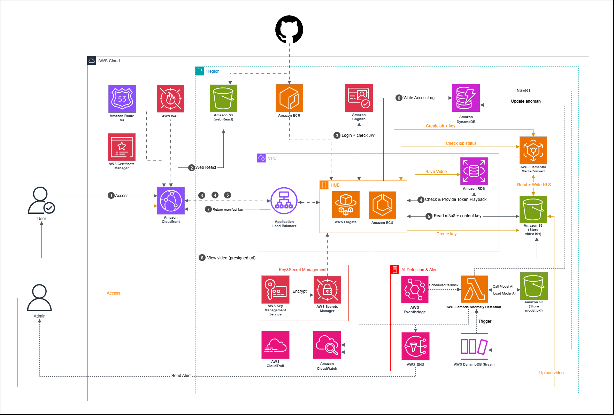

### 1. Problem Statement & Solution Overview
Small and medium-sized educational centers (SMEs) face severe intellectual property leakage when lecture videos are downloaded, screen-recorded, and redistributed illegally. Commercial DRM solutions (Widevine, PlayReady) carry prohibitive licensing fees and integration complexity.

**SecureLearn** is an LMS with a ReactJS frontend and a Spring Boot backend that protects videos in several layers:
* **Media Pipeline:** Instructors upload source videos directly to Amazon S3 using presigned URLs. The Spring Boot backend on Amazon ECS Fargate uses MediaConvert to convert them to HLS (6-second segments) and encrypts every segment with AES-128 using a per-lesson key.
* **Delivery & Access Control:** Students authenticate via Amazon Cognito (JWT). The backend issues a playback token (HMAC-SHA256, 2-hour TTL), only returns the decryption key to the token holder, and serves each segment through a 60-second S3 presigned URL. The ReactJS frontend is delivered through Amazon CloudFront (filtered by AWS WAF), and business data lives in Amazon RDS for PostgreSQL.
* **Security & Key Management:** **AWS KMS** and **AWS Secrets Manager** protect API credentials, while **AWS CloudTrail** logs all audit events.
* **AI & Leak Tracing:** **AWS EventBridge** triggers an **Isolation Forest** Lambda function every 5 minutes to detect abnormal access patterns and send alerts via **Amazon SNS**, paired with a JavaScript dynamic watermark displaying the student's User ID and IP.

### 2. Architecture Diagrams

### 3. Cost Estimation & Optimization

Estimated infrastructure cost for running **SecureLearn** in `ap-southeast-1` (Singapore) under a baseline workload of **100 hours of stored video + 100 hours of playback/month** is **~$165 USD/month** for 24/7 operation, or **~$60–75 USD/month** when scheduling ECS and RDS to run only during working hours (~8 hours/day). *(See also [Budget Estimation in Proposal](../../2-proposal/).)*

| Service | Estimated Monthly Cost | Notes |
| --- | --- | --- |
| **Amazon ECS Fargate** | ~$93.00 | 1 task (2 vCPU / 4 GB RAM + 50 GB ephemeral storage) |
| **Application Load Balancer** | ~$23.00 | 1 ALB, low traffic |
| **Amazon RDS for PostgreSQL** | ~$21.00 | `db.t4g.micro` Single-AZ + 20 GB gp3 |
| **AWS WAF** | ~$12.00 | 1 Web ACL + 7 rules |
| **Amazon S3** | ~$2.00 | ~70 GB HLS segments, frontend, and ML model |
| **AWS KMS** | ~$1.15 | Customer Managed Key for secrets encryption |
| **Amazon CloudWatch & ECR** | ~$0.75 | Audit logs, alarms, and container image storage |
| **AWS Route 53** | ~$0.50 | 1 hosted zone (excluding domain registration) |
| **AWS Secrets Manager** | ~$0.40 | Database, Cognito, and token-signing secrets |
| **Amazon API Gateway** | ~$0.10 | ~20k REST API calls |
| **Cognito, CloudFront, Lambda, DynamoDB, EventBridge** | $0.00 | Covered by AWS Always-Free / Free Tier limits |

**Cost Optimization Practices:**
* **Zero DRM licensing fees:** AES-128 HLS encryption with short-lived presigned URLs and dynamic JS watermarks avoids commercial DRM per-seat/licensing overhead.
* **No NAT Gateway cost:** ECS tasks and Lambda run without a dedicated NAT Gateway, using VPC S3 Gateway Endpoint for private S3 traffic.
* **Serverless & Free-Tier leverage:** Cognito, CloudFront (1 TB/month Always Free), Lambda (50k invocations), DynamoDB On-Demand, EventBridge, and SNS stay within Free Tier under workshop traffic.
* **Scheduled compute & immediate cleanup:** Stop ECS/RDS outside demo hours and follow [Clean Up Resources](../5.6-cleanup/) immediately after testing to eliminate hourly charges.

