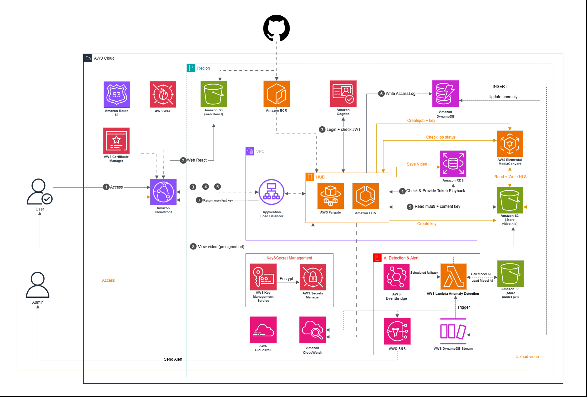

### 1. Bối cảnh Bài toán & Giải pháp
Các trung tâm đào tạo vừa và nhỏ (SMEs) đối mặt với nguy cơ thất thoát tài sản trí tuệ nghiêm trọng do video bài giảng bị tải xuống, quay màn hình và phát tán trái phép. Các giải pháp DRM thương mại (Widevine, PlayReady) có chi phí bản quyền quá cao và tích hợp phức tạp.

**SecureLearn** là một LMS gồm frontend ReactJS và backend Spring Boot, bảo vệ video bằng nhiều lớp:
* **Lớp Upload & Xử lý (Media Pipeline):** Giảng viên upload video gốc thẳng lên Amazon S3 bằng presigned URL. Backend Spring Boot chạy trên Amazon ECS Fargate dùng MediaConvert chuyển video sang HLS (segment 6 giây) và mã hóa AES-128 từng segment bằng khóa riêng cho mỗi bài học.
* **Lớp Phân phối & Kiểm soát truy cập:** Học viên đăng nhập qua Amazon Cognito nhận JWT. Backend cấp playback token (HMAC-SHA256, thời hạn 2 giờ), chỉ trả khóa giải mã cho đúng người giữ token, và mỗi segment chỉ tải được qua presigned URL S3 hạn 60 giây. Frontend ReactJS được phân phối qua Amazon CloudFront (lọc bởi AWS WAF), dữ liệu nghiệp vụ lưu trong Amazon RDS for PostgreSQL.
* **Lớp Bảo mật & Quản lý khóa:** **AWS KMS** và **AWS Secrets Manager** bảo vệ thông tin xác thực API, **AWS CloudTrail** ghi lại toàn bộ nhật ký truy cập.
* **Lớp AI & Truy vết:** **AWS EventBridge** kích hoạt Lambda chạy mô hình **Isolation Forest** mỗi 5 phút để phát hiện hành vi bất thường và gửi cảnh báo qua **Amazon SNS**, kết hợp watermark động hiển thị User ID và IP của học viên.

### 2. Sơ đồ Kiến trúc Hệ thống

### 3. Ước tính & Tối ưu Chi phí (Cost Estimation & Optimization)

Tổng chi phí hạ tầng ước tính để vận hành **SecureLearn** tại region `ap-southeast-1` (Singapore) với kịch bản **100 giờ video lưu trữ + 100 giờ xem/tháng** là **~$165 USD/tháng** khi chạy 24/7, hoặc giảm còn **~$60–75 USD/tháng** nếu chỉ bật ECS và RDS trong giờ làm việc (~8 giờ/ngày). *(Xem thêm mục [Dự toán ngân sách trong Proposal](../../2-proposal/).)*

| Dịch vụ AWS | Chi phí ước tính/tháng | Ghi chú |
| --- | --- | --- |
| **Amazon ECS Fargate** | ~$93.00 | 1 task (2 vCPU / 4 GB RAM + 50 GB ephemeral storage) |
| **Application Load Balancer** | ~$23.00 | 1 ALB, lưu lượng thấp |
| **Amazon RDS for PostgreSQL** | ~$21.00 | `db.t4g.micro` Single-AZ + 20 GB gp3 |
| **AWS WAF** | ~$12.00 | 1 Web ACL + 7 rule |
| **Amazon S3** | ~$2.00 | ~70 GB video HLS, frontend và model AI |
| **AWS KMS** | ~$1.15 | Customer Managed Key bảo vệ secret |
| **Amazon CloudWatch & ECR** | ~$0.75 | Audit logs, alarms và lưu trữ container image |
| **AWS Route 53** | ~$0.50 | 1 hosted zone (chưa tính phí mua tên miền) |
| **AWS Secrets Manager** | ~$0.40 | Lưu mật khẩu RDS, Cognito secret và khóa ký token |
| **Amazon API Gateway** | ~$0.10 | ~20k REST API calls |
| **Cognito, CloudFront, Lambda, DynamoDB, EventBridge** | $0.00 | Nằm trong hạn mức AWS Free Tier / Always Free |

**Các biện pháp tối ưu chi phí:**
* **Không tốn phí bản quyền DRM thương mại:** Dùng mã hóa HLS AES-128 kết hợp presigned URL ngắn hạn và watermark động phía frontend thay cho Widevine/PlayReady.
* **Không dùng NAT Gateway:** Giảm chi phí cố định theo giờ và dùng VPC S3 Gateway Endpoint miễn phí cho lưu lượng nội bộ tới S3.
* **Tận dụng dịch vụ Serverless & Free Tier:** Cognito, CloudFront (miễn phí 1 TB/tháng), Lambda, DynamoDB On-Demand, EventBridge và SNS có chi phí gần như $0 ở quy mô workshop/SME nhỏ.
* **Tắt compute ngoài giờ & dọn dẹp ngay sau demo:** Tắt/xóa ECS, ALB và RDS ngoài giờ thử nghiệm và thực hiện đúng hướng dẫn ở mục [Dọn dẹp tài nguyên](../5.6-cleanup/) ngay sau khi quay demo.

